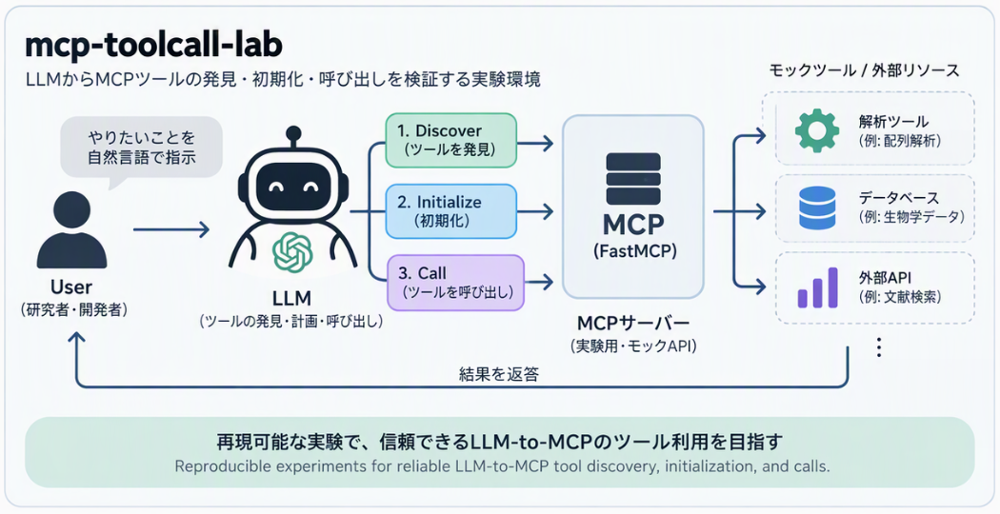

<p align="center">
  
</p>

# mcp-toolcall-lab

**Explore what needs to run, what can be reused, and how to verify the difference.**

This lab began with reproducible LLM-to-MCP tool discovery and invocation tests.
It now also explores reducing repeated work through direct routing, reusable
source snapshots, observation caches, and conservative history compaction.
Adapters separate these experiments from their sources, transports, and model
backends. MCP remains an important interface and test boundary, not the whole
architecture.

The broader direction is **Adaptive Inference / GPU-dependency reduction**:
combine reuse and selective recomputation with suitable CPU, NPU, or partial-GPU
execution, and evaluate distillation and quantization where they actually help.
That is a development direction, **not a claim that a universal inference or
model-conversion engine already exists**. [Issue #147](https://github.com/myon-bioinformatics/mcp-toolcall-lab/issues/147)
tracks that boundary and the acceptance criteria.

- [Implemented lanes and their limits](#implemented-lanes-and-their-limits)
- [What “adapter” means here](#what-adapter-means-here)
- [Quick start](#quick-start)
- [Offline replay and observation-cache reuse](#offline-replay-and-observation-cache-reuse)
- [Clients, traces, and source reuse](#clients-traces-and-source-reuse)
- [Tests and optional experiments](#tests-and-optional-experiments)
- [Documentation and next steps](#documentation-and-next-steps)

## Implemented lanes and their limits

| Lane | Implemented now | Important boundary |
| --- | --- | --- |
| MCP protocol and tool calls | FastMCP Streamable HTTP, generated standalone servers, curl/httpx/SDK tests, LibreChat/Open WebUI integration, correlated JSONL traces | Three tools are deterministic mocks; Wikipedia and pixiv tools perform real public HTTP access when called. |
| Avoiding a selector-LLM call | Typed Jev routing decisions and an assisted executor with confidence/policy fallback; direct Ironmate calls and injected Wikipedia/mock calls | Skipping the downstream selector is not “zero inference”: the decision backend may itself run a model. It is not a general execution planner. |
| Fetch once, inspect locally | HTML snapshots, hash-checked extraction, constrained selectors, offline CSS inspection; Wikipedia/pixiv article reuse | Source retrieval and cached extraction are not model inference. A snapshot is not a browser DOM or proof of source authenticity. |
| Reusing engine observations | `EngineSpec`, `DistilledAdapter`, caller-supplied observations, JSON export/load with a canonical SHA-256 checksum, keyed lookup | Despite the API name, this does not train/distill weights, quantize a model, launch Hugging Face/Docker engines, or execute their model weights. |
| Reducing history work | Conservative compaction, provenance kept out of model messages, numeric history-growth telemetry, a separate real-GGUF benchmark path | Compaction can decline reduction to preserve user instructions. Character estimates are not measured tokens; the optional benchmark reports actual server usage. |

These are related modules and experiments, **not one end-to-end adaptive runtime**.
The default test lane uses fixtures, mocks, and local servers rather than live
external services. Optional network/model lanes are separate; installing the
package or reading a source specification is not evidence that a real model ran.

### What “adapter” means here

- **Source adapters** normalize retrieval/extraction and retain provider-specific
  errors, pagination, version, and provenance. The registry lives in
  [`source_access.py`](src/mcp_toolcall_lab/source_access.py); the provider modules
  live under [`adapters/`](src/mcp_toolcall_lab/adapters/). They do not automatically
  register every operation as an MCP tool.
- **Judgment backends** implement the `Backend.answer()` boundary for fixture,
  TypeSafe-mock, or injected OpenAI-compatible transports. `prob_source` keeps
  fixture values, self-reported model confidence, and other probability sources
  distinct. [`jev_router.py`](src/mcp_toolcall_lab/jev_router.py) decides;
  [`jev_assisted.py`](src/mcp_toolcall_lab/jev_assisted.py) executes or falls back.
- **Engine observation adapters** store a specification and supplied observations
  in [`engine_adapter.py`](src/mcp_toolcall_lab/adapters/engine_adapter.py).
  `DistilledAdapter` is the current artifact/API name, not proof of learned-model
  distillation, a LoRA/PEFT adapter, or a portable replacement for an upstream model.

The engine-cache API has limitations that matter when interpreting a result:
`execute_via_adapter()` selects a stored key, then a `default`, then a fixed
fallback evaluation. An unknown input can therefore return `status: "ok"`
without real evaluation. `device_used` copies the specification's declared
requirement; it does not measure an inference device. `runtime_bounds` are stored
metadata, not enforced resource limits. SHA-256 checks consistency, not producer
authenticity. Do not use those fields as a real-inference receipt.

The planned contract in [#147](https://github.com/myon-bioinformatics/mcp-toolcall-lab/issues/147)
separates cached observations, actual model inference, and approximation/retrieval;
adds explicit miss/unsupported results and measured backend/device provenance;
and only then expands CPU execution, cache/recomputation, and optional optimizers.
Model-weight distillation and quantization remain distinct from today's
observation-cache implementation.

### Traditional MCP validation view



*This supplied illustration shows the original MCP tool-validation facet, not
the full adapter/reuse/Adaptive Inference direction above. It is conceptual, not
protocol ordering: MCP session initialization precedes discovery (`tools/list`)
and calls (`tools/call`). Its analysis, database, and external API examples are
illustrative rather than the current tool catalog.*

## Quick start

### Requirements

- Python **3.12+**. Exact dependency versions are recorded in `uv.lock`; the
  Playwright `pyee` 15 override requires Python 3.12 or newer.
- Core dependencies include FastMCP, MCP, and Pydantic; see [`pyproject.toml`](pyproject.toml).
- `[tool.uv] override-dependencies` lifts upstream Gradio/Playwright caps for
  `pillow`, `safehttpx`, `tomlkit`, and `pyee`. Overrides replace upstream
  Requires-Dist for locking; remove each when upstream metadata permits the fixed
  version. Use the locked uv commands below when those optional lanes are needed.
- Keep this package in its own environment, separate from Open WebUI's environment.
- Docker, browser tooling, Gradio, model weights, and external credentials are
  needed only for their respective optional lanes.

```bash
python -m venv .venv
. .venv/bin/activate
pip install -e '.[test]'
python openwebui_mcp_mock.py
```

If activation is unavailable, use `.venv/bin/python` directly. The server exposes
Streamable HTTP at `http://127.0.0.1:8000/mcp`; it is not a chat UI. In a second
terminal with the same environment, exercise a deterministic mock:

```bash
fastmcp list http://127.0.0.1:8000/mcp --json
fastmcp call http://127.0.0.1:8000/mcp find_municipalities query=Yokohama --json
scripts/mcp_curl_smoke.sh
scripts/mcp_fastmcp_cli_smoke.sh
```

The current shared catalog has seven tools:

- Offline mocks: `find_municipalities`, `find_transaction_prices`, `find_stations`.
- Real Wikipedia HTTP: `fetch_wikipedia_section`, `fetch_wikipedia_article`.
- Real public pixiv Encyclopedia HTTP: `fetch_pixiv_dictionary_section`,
  `fetch_pixiv_dictionary_article`.

Calling a live-source tool can access the network; calling one of the three mock
tools does not. Read [`catalog.py`](src/mcp_toolcall_lab/catalog.py) and the
[source-specific docs](#documentation-and-next-steps) rather than treating the
`*_mcp_mock.py` filename as an offline guarantee for every tool.

`openwebui_mcp_mock.py` and `librechat_mcp_mock.py` are generated from the same
package. Copy the complete client-named file, not isolated functions. After tool
changes, regenerate both with `python -m mcp_toolcall_lab.export`. On a separate
VM/container, the standalone server requires FastMCP (`pip install "fastmcp>=4.1.1"`).
Set `MCP_HOST=0.0.0.0` only when a trusted client must reach it across network
namespaces; this does not add authentication.

## Offline replay and observation-cache reuse

### Select and replay recorded fixtures

From a source checkout, these entry points can run with the standard library
alone. They do not call a provider or load a model:

```bash
PYTHONPATH=src python -S -m mcp_toolcall_lab.prompt_experiment replay --case 'available*' --list
PYTHONPATH=src python -S -m mcp_toolcall_lab.prompt_experiment replay --out test-results/prompt-experiments.jsonl
PYTHONPATH=src python -S -m mcp_toolcall_lab.jev_shim replay --case 'noul*' --exclude '*malformed*'
```

Repeated `--case` rules are ORed; `--exclude` applies afterward. Selection is
case-sensitive and one directory deep, skipping symlinks. `--list` lists selected
JSON basenames without parsing fixture contents or writing an audit, and cannot
be combined with `--out`. Input/selection errors return 2; existing replay verdict
codes remain 0/1. The prompt replay distinguishes raw argument-schema validity
from server acceptance. Fixtures describe their recorded catalog, not necessarily
the current seven-tool server. Comparison JSONL is not an HTTP/MCP wire log.

### Store and reuse a known observation

This is an **observation-cache example**, not model inference. It uses a known
key and never loads weights, starts Docker, or contacts Hugging Face:

```python
from pathlib import Path
from mcp_toolcall_lab.adapters.engine_adapter import (
    distill_engine_adapter, execute_via_adapter, export_adapter_cache,
    extract_engine_spec, load_adapter_cache,
)

spec = extract_engine_spec(
    engine_name="recorded-example",
    source_type="local",
    repo_or_image="fixtures/recorded-example",  # metadata only; not opened
    revision_or_tag="fixture-v1",
)
adapter = distill_engine_adapter(
    spec, {"known-input": {"evaluation_score": 0.25, "source": "fixture"}},
)
path = export_adapter_cache(adapter, Path("test-results/observation-adapter.json"))
restored = load_adapter_cache(path)
result = execute_via_adapter(restored, {"query": "known-input"})
assert result["evaluation"]["source"] == "fixture"
```

Do not interpret the elapsed lookup time as model latency or the declared device
as a measurement. See the limitations above and the
[cache integrity contract](docs/source-adapters.md#cache-checksum-contract-and-compatibility).

## Clients, traces, and source reuse

### LibreChat and Open WebUI

In Open WebUI, add an **MCP (Streamable HTTP)** connection, not OpenAPI:

| Client location | MCP server URL |
| --- | --- |
| Same host | `http://127.0.0.1:8000/mcp` |
| Docker client, server on host | `http://host.docker.internal:8000/mcp` |
| Another VM or compose service | `http://<mock-hostname>:8000/mcp` |

Use the correct bind address/network route. The lab server has no authentication
by default; do not expose it as a public service. For LibreChat, run
`python librechat_mcp_mock.py` and use
[`examples/librechat.mcp.example.yaml`](examples/librechat.mcp.example.yaml) against
the same endpoint rather than starting a second independent mock.

```bash
python -m mcp_toolcall_lab.frontends
python -m mcp_toolcall_lab.chat_ui describe openwebui
# With the real UI running and browser-test dependencies installed:
python -m mcp_toolcall_lab.chat_ui send --client openwebui --url http://127.0.0.1:3000
python -m mcp_toolcall_lab.chat_ui send --client librechat --url http://127.0.0.1:3080
```

The client definitions in [`frontends.py`](src/mcp_toolcall_lab/frontends.py) are
the shared selector/authentication source. A product conversation ID resumes a
product conversation; a lab `chat_*` ID is a trace pin, not a product session ID.

### Trace what actually happened

Set `MCP_TOOLCALL_LOG=toolcalls.jsonl` before starting the server. Direct MCP calls
and chat-simulated calls share JSONL records, distinguished by correlation
metadata. Protocol events, durations, call outcomes, and chat/call IDs can be
joined with the OpenAI mock's wire projection:

```bash
python -m mcp_toolcall_lab.trace_probe kinds
python -m mcp_toolcall_lab.trace_probe --chat-id chat_lab1 \
  --mcp-log test-results/mcp-toolcalls.jsonl \
  --openai-log test-results/openai-mock.jsonl
python -m mcp_toolcall_lab.history_growth test-results/openai-mock.jsonl
```

An empty successful result (`[]`) is not an error. Unknown tools, invalid
arguments, and timeouts are errors. FastMCP's CLI may reject an unknown name
before it reaches the server. `chat_sim.py` models generic OpenAI-compatible
`tool_calls`/`tool` messages, not a product's database or actual UI behavior.
See [conversation identities](docs/conversation-urls.md),
[history telemetry](docs/history-growth-telemetry.md), and
[anti-patterns](docs/antipatterns.md).

### Reuse retrieved content

The stdlib source registry offers offline `html/extract` and `css/inspect`, plus
explicitly network-enabled Wikipedia operations and an optional trusted
Niconico binding. It does not automatically expose a generic network MCP tool.
Use saved snapshots for repeated selector/extraction work; changing a selector
does not fetch linked resources. The explicit capture CLI, snapshot validation,
network opt-in, and extraction limits are documented in
[Source access](docs/source-access.md).

### Static Pages versus local execution

[GitHub Pages](https://myon-bioinformatics.github.io/mcp-toolcall-lab/) is a static
workspace/report, not a hosted Python/MCP inference service. Its tool catalog is
generated from the shared Python catalog; the `#wiki` panel uses browser-side
MediaWiki API access, not MCP. The `#pixiv` panel extracts pasted revision source
offline; it does not fetch the live article like the Python tools. The local
`/wiki` endpoint is a separate stub:

```bash
python -m mcp_toolcall_lab.stub_front turn --heading Yokohama
python -m mcp_toolcall_lab.stub_front serve --port 8765
python -m mcp_toolcall_lab.stub_front pages --out _site --last-run test-results/last-run.json
```

Pages also publishes repository diagnostics and build/run identity. The UI shell
is pinned from web-ui; tool execution, fixtures, traces, and protocol behavior
remain owned here. See [Pages/stub boundaries](docs/stub_pages.md),
[local stub roadmap](docs/stub_front_roadmap.md), and the separate
[Wikipedia-only Deno MCP deployment](docs/wikipedia_mcp_deploy.md).

## Tests and optional experiments

### Default regression suite

```bash
pip install -e '.[test]'
pytest -q
# Reproduce the pinned CI dependency set with uv:
uv run --locked --extra test pytest -q --junitxml=reports/pytest.xml
```

The default lane uses fixtures/mocked external access and local protocol servers.
A passing fixture test is not live-provider or real-model evidence. CI uses
change detection, so documentation-only changes may skip heavier product jobs.
See [Python/JUnit evidence](docs/python_junit_ci.md) and
[vendor automation](docs/vendor-automation.md).

### Actual browser and product integration

```bash
pip install -e '.[test,browser-test]'
playwright install chromium
pytest -q tests/test_browser_fetch_protocol.py
```

That browser test proves same-origin HTTP/MCP access, not a chat UI. Both Docker
lanes exercise real product input/Send and capture traces. Open WebUI asserts the
full tool-call wire, ID correlation, and rendered result; LibreChat records a
successful MCP return or a classified anti-pattern. They use separate stacks:

```bash
# LibreChat
mkdir -p test-results
docker compose -f docker/librechat-smoke/docker-compose.yml up --build -d
LIBRECHAT_BASE_URL=http://127.0.0.1:3080 \
  MCP_TOOLCALL_LOG=$PWD/test-results/mcp-toolcalls.jsonl \
  OPENAI_MOCK_LOG=$PWD/test-results/openai-mock.jsonl \
  pytest tests/real_chat_ui/test_librechat_docker.py -v

# Open WebUI
docker compose -f docker/openwebui-smoke/docker-compose.yml up --build -d
OPEN_WEBUI_BASE_URL=http://127.0.0.1:3000 \
  MCP_TOOLCALL_LOG=$PWD/test-results/mcp-toolcalls.jsonl \
  OPENAI_MOCK_LOG=$PWD/test-results/openai-mock.jsonl \
  pytest tests/real_chat_ui/test_mcp_toolcall_lab_openwebui_docker.py -v
```

These tests are skipped when their UI URL is unset. Docker services use service
DNS, not host-loopback addresses. The dedicated workflows retain logs and trace
artifacts. See [LibreChat notes](docs/librechat_mcp_notes.md) and
[Open WebUI notes](docs/openwebui_mcp_notes.md). Wikipedia screenshots, static Pages
screenshots, and opt-in live pixiv captures are separate evidence lanes; skipped
or failed live captures do not establish success.

### Real-model and compute-reduction experiments

The [compaction GGUF benchmark](docs/compaction-gguf-benchmark.md) has a separate
path that runs a pinned, hash-checked SmolLM2 GGUF with a pinned llama.cpp server.
It compares original/compacted requests using real server token usage and local
HTTP latency, with narrow synthetic quality checks. This is distinct from the
observation-cache adapter. Using an already-quantized GGUF does **not** mean this
repository quantized or distilled the model.

Conservative compaction may deliberately retain the original history, especially
when removing prior user instructions would be unsafe. Read
[compaction safety](docs/compaction-safety.md) before interpreting reductions.
Do not generalize fixture accuracy, cache lookup timing, character estimates, or
one model/device result into universal quality or GPU-replacement claims.

Jev paths also distinguish offline replay, injected/mock transports, and explicit
live experiments. The actual TypeSafe `/v1/systemone` wire and the separate
OpenAI-compatible JSON-schema adapter are not interchangeable. Self-reported
confidence is not a calibrated probability. See
[backend contracts](docs/jev_backend.md), [router semantics](docs/jev_router.md),
[offline benchmark](docs/jev_benchmark.md), and
[live benchmark requirements](docs/jev_live_benchmark.md).

### Optional local Galleria

```bash
uv sync --locked --extra test --extra galleria
uv run --locked --extra test --extra galleria python -m mcp_toolcall_lab.gradio_galleria
```

Run from a source checkout because the vendored ASCII/Markdown helpers are
required. This localhost-only editor/viewer needs no model, GPU, or MCP server.
It uses local filesystem paths and is not a public file service. Its dedicated
workflow checks lockfile consistency with `uv lock --check`, imports Gradio and
FastMCP, and tests UI/HTTP behavior plus MCP Streamable HTTP in the same
environment. It preserves the `galleria-junit` artifact separately from the core
test lane. `uv pip check` can disagree with the overridden upstream metadata;
lock consistency and the exercised UI behavior are separate checks.

## Documentation and next steps

- **Sources and adapters:** [Source access](docs/source-access.md),
  [source adapter ownership/cache integrity](docs/source-adapters.md),
  [Wikipedia](docs/wikipedia_tool.md),
  [pixiv fixture contract](docs/pixiv_source_fixture_contract.md),
  [pixiv normalization](docs/pixiv_markup_normalization.md).
- **Routing and judgments:** [Jev wire/calibration](docs/jev_shim.md),
  [backend contracts](docs/jev_backend.md), [router](docs/jev_router.md),
  [Ironmate boundary](docs/jev_ironmate_routing.md),
  [direct Wikipedia/mock routes](docs/jev_family_direct.md).
- **MCP and UIs:** [LibreChat](docs/librechat_mcp_notes.md),
  [Open WebUI](docs/openwebui_mcp_notes.md),
  [Open WebUI schema notes](docs/openwebui_schema_notes.md),
  [GitHub operations MCP](docs/github_ops_mcp.md),
  [chat/stub contract](docs/chat_stub_contract.md).
- **Evidence and reproducibility:** [Anti-pattern catalog](docs/antipatterns.md),
  [conversation URL identities](docs/conversation-urls.md),
  [history telemetry](docs/history-growth-telemetry.md),
  [compaction benchmark](docs/compaction-gguf-benchmark.md),
  [CI/JUnit](docs/python_junit_ci.md), [vendor updates](docs/vendor-automation.md).

The next Adaptive Inference increments are tracked in
[#147](https://github.com/myon-bioinformatics/mcp-toolcall-lab/issues/147):

1. Make observation/cache semantics explicit, remove misleading success/device
   reporting, and distinguish miss/unsupported/error from evaluated results.
2. Add a narrow optional real CPU backend to the engine-adapter contract, with
   pinned inputs and measured correctness, latency, memory, and actual-device
   evidence.
3. Evaluate exact-cache invalidation, retrieval/selective recomputation, and
   backend-native cache reuse without conflating them with inference.
4. Explore optional quantization/optimization and capability/budget-aware
   CPU/GPU/NPU planning; validate each supported model/device and quality trade-off.

These are planned phases, not guarantees about today's API. Keep tests and
receipts for cached replay, approximate results, and actual model execution
separate, and preserve an explicit fallback when a route is unsupported.
